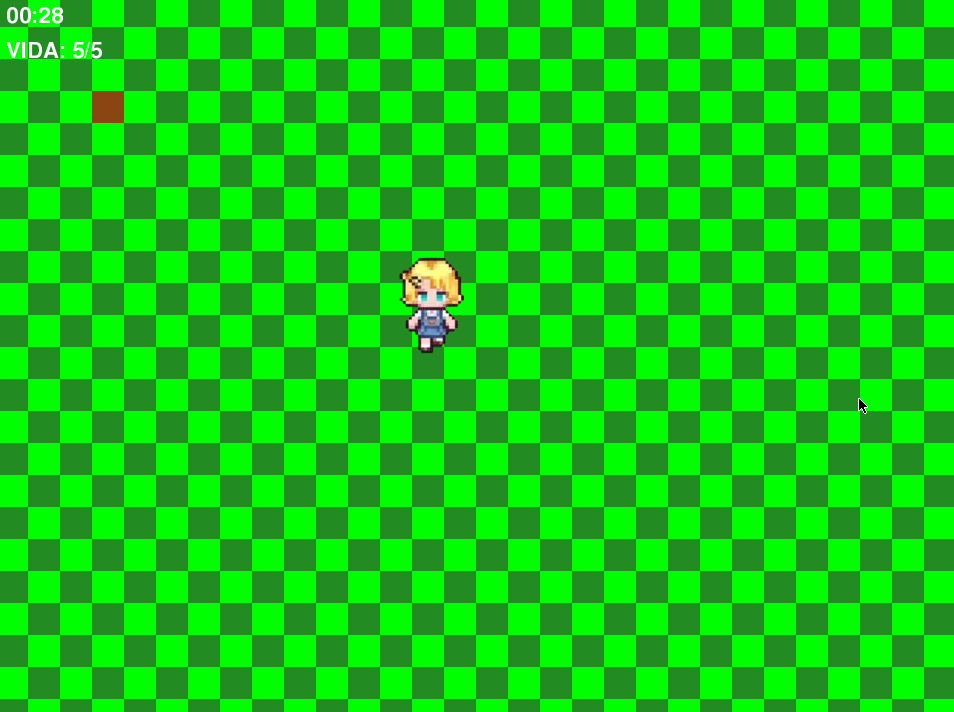
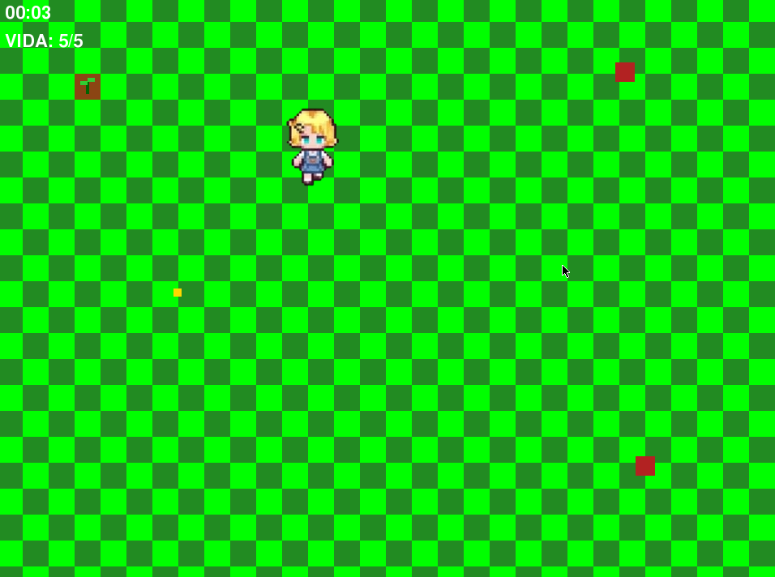

# 🎮 Roguelike Pygame Project

This is a Roguelike game project built in Python using the `pygame` module.

### 📸 Project Previews

| Gameplay 1 | Gameplay 2 |
| :---: | :---: |
|  |  |

**The story behind the project:**
It all started with the idea of making a farming game like *Stardew Valley*. However, while looking for tutorials, I got frustrated seeing that 99% of videos use Pygame to make *Flappy Bird* clones. So, I decided to take my own path and build something different from scratch.

This is the first step. There is still a lot missing, but the goal is to keep improving little by little.

## 🚀 Roadmap (Upcoming features)
The project is currently in its first version. The next goals are:
- [ ] Add more player animations.
- [ ] Implement enemies.
- [ ] Add a wave system.
- [ ] (Note: Sprite sizes are documented in the file with the same name inside the project).

## 🧠 Development Philosophy & AI Usage
In this project, I use AI tools (like Codex CLI on Gentoo) to make improvements and learn. I don't believe in "vibecoding" (letting the AI do everything), but rather in AI as a means to solve problems.

I see it like the historical **Garry Kasparov vs. Deep Blue** match: the machine's victory didn't mean the death of chess, but its transformation. I feel the same is happening with programming. AI is a tool, and we are still the players.

## 🛠️ Tech Stack
- Python 3
- Pygame

## 🤝 Feedback & Contributions
This is my first version and I'm open to learning. If you want to suggest an improvement, report a bug, or tell me what flaws this first version has, I will gladly accept your feedback!

---
*Thanks for reading and for checking out my project. Have a nice day and be careful :3!*
