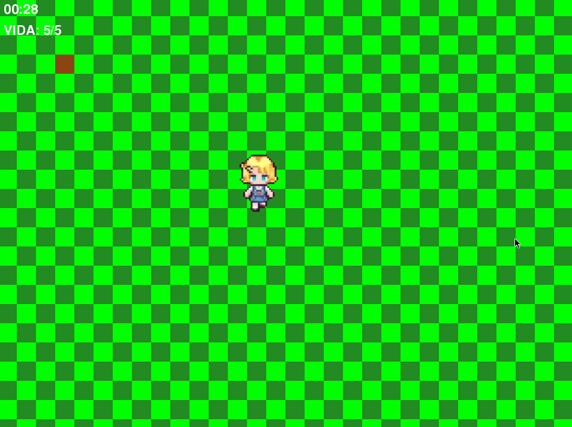
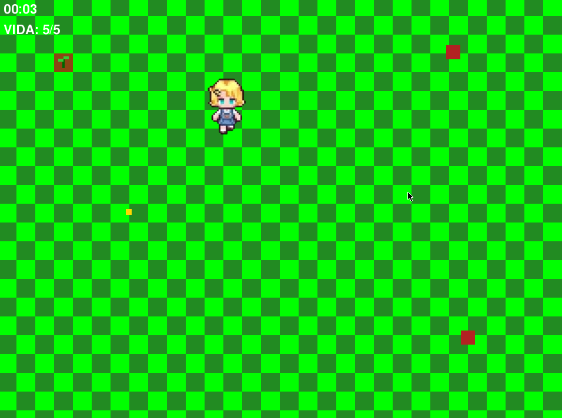

# 🎮 Proyecto Roguelike en Pygame

Este es un proyecto de un juego Roguelike desarrollado en Python usando el módulo `pygame`.

### 📸 Vistas del Proyecto

| Jugabilidad 1 | Jugabilidad 2 |
| :---: | :---: |
|  |  |

**La historia detrás del proyecto:**
Todo empezó con la idea de hacer un juego de granja estilo *Stardew Valley*. Sin embargo, al buscar tutoriales, me frustró ver que el 99% de los videos usan Pygame para hacer clones de *Flappy Bird*. Así que decidí tomar mi propio camino y construir algo diferente desde cero.

Este es el primer paso. Todavía falta mucho, pero la meta es seguir mejorando poco a poco.

## 🚀 Hoja de ruta (Próximas mejoras)
Actualmente el proyecto está en su primera versión. Los siguientes objetivos son:
- [ ] Agregar más animaciones al jugador.
- [ ] Implementar enemigos.
- [ ] Añadir un sistema de oleadas.
- [ ] (Nota: El tamaño de los sprites está documentado en el archivo con el mismo nombre dentro del proyecto).

## 🧠 Filosofía de Desarrollo y Uso de IA
En este proyecto utilizo herramientas de IA (como Codex CLI en Gentoo) para realizar mejoras y aprender. No creo en el "vibecoding" (dejar que la IA lo haga todo), sino en la IA como un medio para resolver problemas.

Lo veo como la histórica partida de **Garry Kasparov vs. Deep Blue**: la victoria de la máquina no significó la muerte del ajedrez, sino su transformación. Siento que lo mismo está pasando con la programación. La IA es una herramienta, y nosotros seguimos siendo los jugadores.

## 🛠️ Tecnologías utilizadas
- Python 3
- Pygame

## 🤝 Comentarios y Contribuciones
Esta es mi primera versión y estoy abierto a aprender. Si quieres sugerir alguna mejora, reportar un bug o decirme qué fallos tiene esta primera versión, ¡con gusto aceptaré tus respuestas!

---
*Gracias por leer y por ver mi proyecto. ¡Que tengas un buen día y cuidado :3!*
